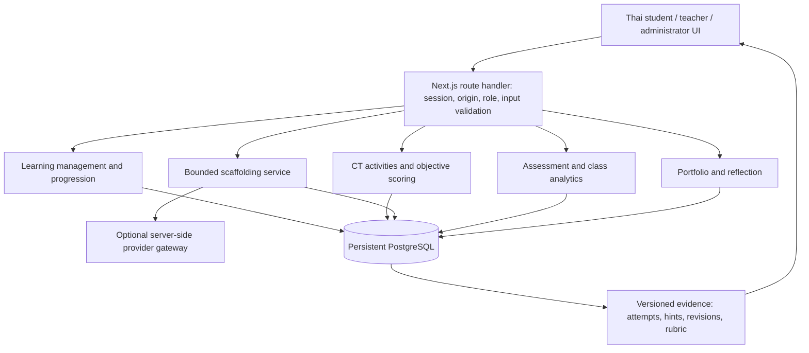

# Architecture and learning rationale

## Five layers, one deployment

Presentation knows public lesson shapes and request contracts. Application services determine progression/scoring/permissions. Integration handles HTTP, authentication and optional provider calls. Persistence owns SQL transactions and constraints. Netlify's Next.js adapter hosts the single full-stack app. Adding LTI/xAPI/SSO later belongs at integration boundaries, not in lesson UI components.

## The five functional modules

| Function | Implementation | Educational reason |
|---|---|---|
| Learning management | catalog + enrollment + learning service | Predictable scaffolded sequence, short stages, clear goals |
| CT activity engine | select/keep-remove/order games + practice | Learning by doing and debugging using familiar contexts |
| AI scaffolding | four actions × three levels with stage gates | Cognitive scaffolding that fades; autonomy to request support |
| Assessment and analytics | quiz scorer, teacher rubric, class report | Separate formative evidence from independent assessment |
| Portfolio and reflection | append-only attempts + reflections + feedback | Self-comparison and reflection, without ranking children |

Missions cover decomposition, pattern recognition, abstraction and algorithm design. Rules derive completion, badges and available missions on the server. No speed targets or loss of earned badges. A retry is retained and feedback is formative; games have no grade effect. Badges indicate completed practice, not a machine judgement of writing quality. Teachers can hide badges per class.

## Evidence flow

1. A student submits a guided approach. Zod validates it; session determines owner; server verifies class assignment and prior stages.
2. The server locks that learner's row, checks the request UUID, appends the versioned attempt, and returns saved evidence.
3. A requested hint verifies stage, level, final lock and hourly quota. Prepared or provider response is logged with its source.
4. A changed practice submission links the new attempt to hints since the preceding practice attempt. Identical text is not counted as a revision. A revision is not automatically called successful.
5. Quiz scoring uses the enrollment's immutable catalog. Public content omits keys and answer-specific feedback. The enrolled version does not silently switch when a new version is published.
6. Final assessment requires all four missions; an explicit start locks hints/quiz changes. Four-part draft versions are retained. One final submission waits for authorized teacher review.
7. Teacher selects rubric levels and cites evidence for each criterion. Reviews append rows. The profile uses latest review + best pre-final quizzes. Student reflection follows feedback.

## Research export

JSON preserves schema version, export time, student pseudonym, enrolled content version, and separate attempt kinds: diagnostic, game, guided, independent, quiz, module reflection, final drafts, final submission and post-review reflection. Hint records include levels/actions/sources and revision indicators. Rubric has per-skill scores/evidence and feedback. Researchers can separate assistance exposure from independent performance. Missing review remains null. Averages use only reviewed students and report that denominator.

## Permissions

Students read/write only the identity from their session; no student ID in a mutation can choose another owner. Teachers access classes via `teacher_classes`; this guard covers review, exports, assignments and evidence. Admin can create classes and provision individual accounts. Queries are parameterized. A learner-row transaction plus uniqueness constraint provides idempotence under reconnection and multiple serverless workers.

Session persistence is PostgreSQL-based, not browser role flags. Shared-device drafts are tab-scoped and cleared on logout/idle privacy lock. The public cached reader contains teaching text only. There is no class roster or peer work in student responses.

## Versioning and operations

Keep applied migrations immutable. Add new migrations for changes. Bump the catalog version when changing assessment semantics; enroll new students into the current version, preserve existing enrollments. If future editing UI is added, publish immutable versions through the same service contract. The current release has no automatic re-enrollment or destructive content migration.

Curriculum connection: logical reasoning, problem decomposition, data interpretation and step design in Thai primary computing. Exact official indicator codes are intentionally not asserted without verified curriculum source wording. This is an instructional design, not evidence that a research intervention is effective.
